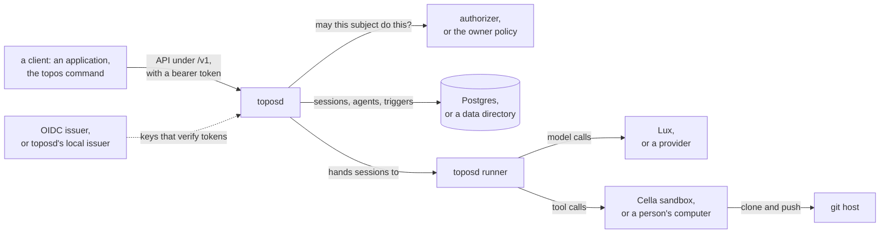

# Topos

**Topos runs AI agents, and keeps each session as an append-only log
that any runner can continue.** It holds agent definitions
and the sessions people have with them, and runs each session's loop:
model calls through [Lux](https://github.com/latere-ai/lux) or a
provider, tool calls on a [Cella](https://github.com/latere-ai/cella)
sandbox or a person's own computer, and every action decided by the
installation's authorizer. On a server, a session whose runner stops is
taken over by another runner from its log.

[](https://github.com/latere-ai/topos/actions/workflows/verify.yml)
[](https://pkg.go.dev/latere.ai/x/topos)
[](LICENSE)

## Status

Topos is before 1.0: a minor release may still change the API, the
agent manifest or the configuration, and its section in the
[changelog](CHANGELOG.md) says what changed and what an operator must
do. The [releases page](https://github.com/latere-ai/topos/releases)
lists every release with its signed image and binaries. Topos has had
no external security audit; [SECURITY.md](SECURITY.md#what-is-protected)
lists what it commits to and the test that holds each commitment.

The repository restarted on 2026-09-26, and the core's releases start at
v0.9.0. The Go packages of v0.7.0, an embeddable runtime, are gone from
`main` and stay available at their tags through the Go module proxy;
[docs/history](docs/history) holds their specs.

| Area | Built | Designed, not built yet |
|---|---|---|
| Sessions | the session log in memory, in a directory or in Postgres; forks, archive, summaries, delete, and search over what sessions said | external runners that append to a session, and handoff between them |
| The loop | the built-in tools, approval modes, subagents, context compaction, and a checkpoint of the working directory at every turn | |
| Running it | `topos run`, `confirm` and `rewind` on your own machine with no server; `toposd`, which serves the API under `/v1` with its OpenAPI document and runs hosted sessions on Cella sandboxes, in its own process or in separate runners | `toposd check` and the conformance suite; the release archives |
| People in a session | the `question` tool, approval mode and title changes after the start, edited messages with their forks kept as a tree, messages sent while the agent works | |
| Agents and triggers | agents owned by a person or an organization; triggers on a schedule, at listed times or on delivered events, with weekly allowances | |
| Machines | a sandbox that failed is started again with its files; a working directory rebuilt from the log; the sites a session's machine may reach, set per session | |
| Models | a routed model name, reasoning levels, and a move to another model inside a turn when one cannot serve, each chosen by the authorizer | |
| Connections and tools | services a person connected, reached from the sandbox with no credential in it; remote MCP servers the authorizer names; `web_search`; `publish` of a folder as a site; memory folders | write-only credentials; MCP servers an agent's own definition names |
| Decisions | a decision service that suggests a verdict for each tool call, with the layer that decided each call recorded | |
| Observability | | the event sink |

The task suite runs, but no release has measured its bar against a
pinned model yet. [specs/README.md](specs/README.md) is the design and
says which build phases are closed.

## Quickstart

Install Go 1.27 or later, `make`, `openssl`, `curl` and `git` first.
This runs [Lux](https://github.com/latere-ai/lux) with its stand-in
providers as the model connection, so it needs no provider key, no
database and no sandbox service. Run it in one shell:

```sh
git clone https://github.com/latere-ai/lux.git
git clone https://github.com/latere-ai/topos.git
cd lux
eval "$(make run | grep '^export ')"
cd ../topos
export TOPOS_MODELS_URL=$LUX_URL TOPOS_MODELS_KEY=$LUX_KEY TOPOS_DATA_DIR=$PWD/out/data
mkdir -p out
make run > out/toposd.log 2>&1 &
until curl -sf http://127.0.0.1:8080/readyz > /dev/null; do sleep 1; done
TOKEN=$(make token)
curl -sS -X PUT http://127.0.0.1:8080/v1/agents/hello \
  -H "Authorization: Bearer $TOKEN" -H 'Content-Type: application/yaml' \
  --data-binary @- <<'YAML'
apiVersion: topos.latere.ai/v1
kind: Agent
metadata:
  name: hello
spec:
  model:
    name: stub-anthropic
    inputWindow: 200000
    maxOutputTokens: 4096
  machine:
    kind: cella
YAML
SESSION=$(curl -sS -X POST http://127.0.0.1:8080/v1/sessions \
  -H "Authorization: Bearer $TOKEN" -H 'Content-Type: application/json' \
  -d '{"agent":"hello","message":"hello"}' | sed -n 's/.*"id":"\(ses_[^"]*\)".*/\1/p')
until curl -sSL http://127.0.0.1:8080/v1/sessions/$SESSION/events \
  -H "Authorization: Bearer $TOKEN" | grep -q '"status":"idle"'; do sleep 1; done
curl -sSL http://127.0.0.1:8080/v1/sessions/$SESSION/events \
  -H "Authorization: Bearer $TOKEN" |
  sed -n 's/.*"type":"agent.message".*"blocks":\[{"type":"text","text":"\([^"]*\)".*/\1/p'
```

The last command prints the agent's reply,
`stub:anthropic:stub-anthropic:2cf24dba`. The agent names its model's
input window and output limit because the stand-in models list none,
and `machine: kind: cella` because a server with no sandbox service
refuses an agent that names no machine. Lux and `toposd` keep running
in the background; [docs/local.md](docs/local.md) says what each command
did, how to use a real model, Postgres or a sandbox, and how to stop
everything.

## How it fits



Topos is three parts over one session schema.

- **The session log** is an append-only record of typed events: the
  messages, every tool call and its result, every model request, and the
  session's status. The transcript a model sees is a pure function of the
  log, so any runner continues a session from it.
- **The harness** is the loop: it builds each model request from the log,
  calls the model, runs the tool calls on the session's machine under the
  session's permissions, and compacts the context when it grows.
- **A runner** holds one session's write and drives the harness. It runs
  inside the `topos` command on a laptop, inside `toposd serve`, or as a
  separate `toposd runner`.

`toposd` verifies a caller's token against the OIDC issuers an operator
lists, and asks one authorizer for every action; with no authorizer
configured, a built-in owner policy decides. It decides nothing about a
person itself. [docs/authorizer.md](docs/authorizer.md) is that contract.
A session's tools act on one machine: the runner's host, confined to a
working directory; a Cella sandbox; or a person's own computer, in a
folder they granted, through the Cella environment it serves. An
installation can add a connection service, a files service, a search
service, an app host and a decision service, each in
[docs/configuration.md](docs/configuration.md).

## Documentation

| Page | What you find there |
|---|---|
| [docs/README.md](docs/README.md) | every page, grouped by reader, including one page per feature a client shows |
| [docs/local.md](docs/local.md) | the server on one machine with everything it needs, ending in a session that answers |
| [docs/install.md](docs/install.md) | the image and its signature, the database, keys, probes, the manifests, upgrading |
| [docs/configuration.md](docs/configuration.md) | every `TOPOS_*` variable, its default, and what refuses a start |
| [docs/api.md](docs/api.md) | the concepts, the flows a client follows, the errors to branch on |
| [api/openapi.yaml](api/openapi.yaml) | the full API reference, also served by `toposd` |
| [docs/authorizer.md](docs/authorizer.md) | the question `toposd` asks an authorizer, the vocabulary, the answer, and the default without one |
| [docs/security.md](docs/security.md) | what Topos guarantees, what it sees and keeps, what it does not defend, and what an operator keeps safe |
| [specs/README.md](specs/README.md) | the design, the index of specs and the build order |
| [CHANGELOG.md](CHANGELOG.md) | what each release changed for whoever runs or calls it |

## Contributing

[CONTRIBUTING.md](CONTRIBUTING.md) covers setting up, the quality gate and
the layout. Report a vulnerability as [SECURITY.md](SECURITY.md)
describes, never in a public issue.

## License

[Apache-2.0](LICENSE).
