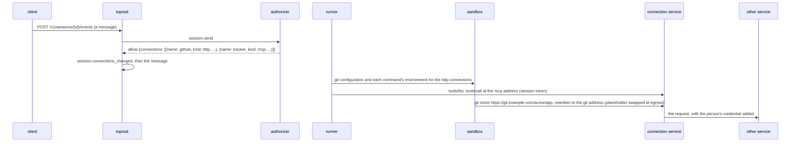

# Connections an allow names

## Overview

A person connects the services they work with, such as a code host or
an issue tracker, at an installation that keeps those connections. The
installation's connection service holds each service's credential,
serves the connection at addresses of its own, and adds the credential
on the way out ([[018-credentials-and-secrets]]). A session reaches
those addresses with its own session token and never holds a
credential of another service.

This spec says how a session learns which connections it has and how
it uses them:

| Kind | What the session gets |
|---|---|
| `http` | git in the sandbox clones and pushes through the connection's git address with the usual URL, and the service's API is one environment variable away, both with a placeholder of the session's token that Cella's egress gateway swaps in |
| `mcp` | the remote Model Context Protocol server at the connection's address, its tools offered to the model, gated, scored and logged like any tool ([[021-mcp-servers]]) |

The installation's authorizer names the connections in its allow, at
the create, at a fork and at every send, so a person who connects a
service in the middle of a conversation has it from their next message.
A block of the system prompt names each connection and says how to use
it. An allow may also name a service the installation offers and the
person has not connected, which the model may ask the person to connect
with `request_connection`.

## Current state

- An allow of `session.create` carries members the core applies
  (`authorizer.Limits`, `DecodeLimits`): a model, a network, a scope,
  the initiator's instructions ([[053-the-initiators-instructions]]),
  and the repositories and context of [[058-what-a-create-allow-attaches]].
  An allow of `session.send` may name the model and the network, which a
  send records as `session.model_changed` and `session.network_changed`
  before what it sent ([[052-a-sessions-network]]). A member the core
  does not know is ignored, and a known member that does not decode
  refuses the request `authorizer_unavailable`.
- A hosted session's sandbox holds Cella Secrets as placeholders the
  egress gateway swaps: its Lux key (`-lux`, `LUX_KEY`) and its git
  host's token (`-origo`, `ORIGO_TOKEN`), applied at each open, renewed
  while a drive runs and deleted at the session's end
  (`internal/hosted`, [[018-credentials-and-secrets]]). The git host's
  placeholder is written into git's global configuration in the
  sandbox's `HOME` when the sandbox opens, before any repository is
  delivered ([[019-git]]).
- A Cella sandbox's `spec.env` cannot change after its create, and the
  placeholder of a Secret mounted later reaches the gateway's map but
  never the running sandbox's environment: Cella's update recompiles the
  boundary and does not call the driver, and no read returns a
  placeholder (Cella's manifest contract, the mutability of `env` and
  `secrets[]`; its egress and secrets design).
- No MCP client exists. 018 and 021 say an installation
  that keeps connections serves them itself and the runner sends the
  session's own token, and leave how an allow names them to this spec.

## Design



### The member

An allow of `session.create`, `session.fork` and `session.send` may
carry `connections`:

```json
{
  "connections": [
    {"name": "github", "kind": "http", "title": "GitHub", "audience": "connections",
     "address": "https://connections.example.com/v1/connections/c_1/http",
     "git_address": "https://connections.example.com/v1/connections/c_1/git",
     "git_url": "https://git.example.com",
     "account": "ada", "api_url": "https://api.git.example.com"},
    {"name": "tracker", "kind": "mcp", "title": "Issue tracker", "audience": "connections",
     "address": "https://connections.example.com/v1/connections/c_2/mcp",
     "read_only": ["list_*", "get_*", "search"]}
  ]
}
```

| Field | Rule |
|---|---|
| `name` | a lowercase DNS label that starts with a letter, at most `session.MaxConnectionName` (32) characters, unique in the list; it names the connection's environment variable and its tools |
| `kind` | `http` or `mcp`; any other value does not decode |
| `title` | one line, 1 to `session.MaxConnectionTitle` (100) characters, no control character; what the model and a client call the connection |
| `audience` | the core a session token for the connection is addressed to: 1 to 256 bytes, no space and no control character |
| `address` | an absolute `https` URL with a host, no user information, no query and no fragment: the forwarding address for `http`, the MCP address for `mcp` |
| `git_address`, `git_url` | `http` alone, both or neither: `git_address` the connection's git address, as `address` is held; `git_url` the git host the person's repositories live at, such as `https://git.example.com`, an `https` URL as `address` is held, unique in the list, a trailing `/` dropped |
| `read_only` | `mcp` alone: at most `session.MaxReadOnlyTools` (64) globs over the server's tool names, in `path.Match` syntax, each 1 to 128 bytes; a tool a glob matches reads |
| `account` | optional: the account at the other service the connection acts as, such as a login or an email address, one line of 1 to `session.MaxConnectionAccount` (256) characters, no control character |
| `api_url` | optional, `http` alone: the service's own API base URL, which `address` stands in for, such as `https://api.example.com`, an `https` URL as `address` is held, a trailing `/` dropped; two connections may name one, as two services of one provider do |

At most `session.MaxConnections` (32) connections, connected and
available ([below](#a-service-the-person-has-not-connected)) together. A
member of a connection the core does not know is ignored. A connection that breaks
a rule, or a list past its bound, does not decode, and the request is
refused `authorizer_unavailable` with the member named in the developer
detail, as `DecodeLimits` refuses any member.

### Where it is kept, and when it changes

- `Session.Connections []session.Connection`, in the header.
- **Create and fork.** The allow's list is the session's. A fork is
  asked as a create is and holds its own allow's list, never its
  parent's, as [[058-what-a-create-allow-attaches]] does for what an
  allow attaches.
- **Send.** The allow's list replaces the session's. A send whose allow
  names a list other than the header's appends
  `session.connections_changed` in the send's batch, after the model's
  and the network's changes and before what it sent, so the turn the
  send starts runs with it. An allow that names no `connections` member
  leaves the session with none: the installation's authorizer answers
  every send the same way, and a disconnected service must stop being
  reached at the next message.
- `session.connections_changed`: appended by the server, not visible,
  payload `connections`, the session's list from here on, empty for
  none. The header takes it, except in a fork's copied events
  ([[004-session-log]]).
- The Session object of [[015-api]] carries `connections`. Nothing in it
  is a credential: an address answers only a caller with a token the
  connection service accepts.

**At the server.** A connection of kind `http` reaches the sandbox
through the one Secret below, so the server holds it to the
installation's connection service: an allow with an `http` connection
on an installation without `TOPOS_CONNECTIONS_URL`, or whose `audience`
is not `TOPOS_CONNECTIONS_AUDIENCE`, or whose `address` or
`git_address` is on another host than `TOPOS_CONNECTIONS_URL`'s, is
refused `authorizer_unavailable` naming the connection. A connection
of kind `mcp` is reached by the runner, which may address any audience
the installation mints for.

### Kind `http`, in a Cella sandbox

**One Secret per session.** On an installation with
`TOPOS_CONNECTIONS_URL`, the runner applies a Cella Secret for every
sandbox it opens, whether or not the session has a connection yet:
named after the sandbox with `-connections`, holding the session's
token for `TOPOS_CONNECTIONS_AUDIENCE` and the workload `sandbox`
(`TokenSource.Token(ctx, audience, "sandbox")`), scoped to the host of
`TOPOS_CONNECTIONS_URL`, injected as a bearer in `Authorization`,
mounted as `CONNECTIONS_TOKEN`, labeled, renewed and deleted with the
session as the sandbox's other Secrets are
([[018-credentials-and-secrets]]). Its placeholder is the only value of
it the sandbox holds. An installation that mints nothing for the
audience (`not_minted`) mounts none, and an `http` connection's
requests then carry no bearer.

The Secret is mounted at every sandbox's creation because a Cella
sandbox takes its mounts' placeholders into its environment at its
create and never later. A Secret mounted only once a session had a
connection would leave every sandbox opened before the person's first
connection without the placeholder for the rest of the session.

**git.** When the sandbox opens, and at the start of each turn, the
runner rewrites one file of git configuration in
the sandbox, `$HOME/.config/topos/connections.gitconfig`, whole, and
names it once in git's global configuration as an `include.path`
([[019-git]] puts the git host's header in the same global
configuration). For each `http` connection with a `git_address`:

```
[url "<git_address>/"]
	insteadOf = <git_url>/
[http "<git_address>/"]
	extraHeader = Authorization: Bearer <placeholder of CONNECTIONS_TOKEN>
```

so `git clone <git_url>/acme/app` goes through the connection, and a
repository a session names on that host is delivered through it, since
the file is written before any delivery. A connection the list no
longer names leaves no entry, because the file is written whole. A
sandbox without git has nothing to configure.

**The API.** Each command the runner runs in the sandbox carries, in
its own environment, `<NAME>_API_URL` naming each `http` connection's
`address`, `<NAME>` the connection's name upper-cased with each `-` as
`_`, from the session's list at the turn's start. It is not in the
sandbox's environment, which is fixed at the sandbox's create. The
bearer is `$CONNECTIONS_TOKEN`.

**Egress.** The connection service's host is the Secret's, which Cella
admits under an allowlist as every mounted Secret's host. Nothing
reaches `git_url`'s host itself.

**A host machine.** An `http` connection is applied in a Cella sandbox
alone: a host machine's git and environment are the person's own
([[009-machines]]), and the block below does not name it there.

### A Secret on another Secret's host

Cella refuses a sandbox that mounts two Secrets whose scopes can match
one host, `secret_host_conflict`. A sandbox's Lux key is scoped to the
host Lux publishes its doors under ([[018-credentials-and-secrets]]),
its git host's token to `TOPOS_ORIGO_URL`'s host, and `-connections` to
`TOPOS_CONNECTIONS_URL`'s. A connection service on either other host
would fail every sandbox's create, and with it every hosted session
that opens a machine. Two layers keep a connection from doing that:

- **At the start.** Configuration refuses `TOPOS_CONNECTIONS_URL` on the
  host of `TOPOS_MODELS_URL` or `TOPOS_ORIGO_URL`. The host Lux
  publishes its doors under is known only once serve and the runner
  role discover Lux's doors at their start, and may differ from
  `TOPOS_MODELS_URL`'s, as an address inside the installation's network
  does. A connection service on that host stops the start, with a
  message that names the service's URL, the published root and their
  host.
- **At a sandbox's open.** A connection never fails a sandbox. A
  `-connections` Secret whose host can match a host another Secret the
  sandbox mounts is scoped to, by Cella's own rule, is not applied, and
  the runner logs one error naming both Secrets and their hosts, never a
  value. A create that mounts it and that Cella still refuses
  `secret_host_conflict` is made once more without it, after one error
  that names its host, the other Secrets' hosts and Cella's refusal; the
  Secret is then not renewed, and the session's end deletes it with the
  others.

A sandbox without the mount reaches none of the session's `http`
connections for as long as it lives: it takes no git configuration and
no `<NAME>_API_URL`, the block names none of them, connected or
available, and `request_connection` asks for none, as on a host
machine. Whether it has the mount is read from the sandbox Cella holds,
so a later drive that finds it by name reaches none either, and neither
does a sandbox opened before the installation set
`TOPOS_CONNECTIONS_URL`. Connections of kind `mcp` are the runner's and
are named and listed as before. A request sent before the sandbox
opened names its `http` connections, since only an open sandbox can say
it does not reach them; the next request names none, one move of the
cached prefix.

### The model is told

`context/connections-v3`, rendered from the session's header on every
request, on every thread, after the attachments block of
[[058-what-a-create-allow-attaches]], when the session has a connection
the block names:

```
<connections>
The person connected these services, and you can use them now. You need no sign-in or key of theirs: the connection adds their credentials to each call. When a task needs one of them, use it rather than saying you cannot reach it.
- GitHub, connected as ada: $GITHUB_API_URL stands in for https://api.git.example.com, so call https://api.git.example.com/<path> as `curl -s -H "Authorization: Bearer $CONNECTIONS_TOKEN" "$GITHUB_API_URL/<path>"`. `git clone https://git.example.com/<owner>/<repository>`, fetch and push work as usual and go through the connection; push your own branch, agents/assistant/ses_01..., and no other.
- Issue tracker: its tools are named mcp__tracker__<tool>.
A request that answers 409 with the code connection_not_connected means the person has to connect that service again: tell them so, naming it, and go on without it.
</connections>
```

An `http` connection without `account` names no account, and one
without `api_url` says its variable stands in for the service's own API
base URL and calls its API's `<path>`, so a block of an authorizer that
names neither still tells the model what to call.

Version 2, which v0.35.0 and v0.36.0 carry, opened with "Services the
person connected. The installation adds their credentials on the way
out, and this machine holds none of them." and gave each `http`
connection only "its API's base URL is $GITHUB_API_URL, in place of the
service's own". A session on a small model read that as having no
access: asked to summarize a person's mail, with the mail service
connected and named in the block, it answered that it could not reach
their mail and asked them to connect it with `request_connection`,
which refused, since the service was connected. A larger model called
the service through the same block. Version 3 says the services can be
used now, names the account, the service's own base URL the variable
stands in for, and one call written out. Version 1, which v0.34.0
carries, names connected connections alone.

The block changes only when a send changes the list, or when the
session's sandbox opens without the connection service's Secret
([above](#a-secret-on-another-secrets-host)), so the prompt's cached
prefix moves once per change and not per turn ([[010-context]]).

### Kind `mcp`

The runner reaches each `mcp` connection as a streamable HTTP server of
[[021-mcp-servers]], at `address`, with `Authorization: Bearer` and the
session's token for `audience` and the workload `session`, asked of the
drive's token source for every request, so a renewed token reaches the
next one and none outlives its scope.

**Protocol.** Revision 2026-07-28 of the Model Context Protocol. Every
message is its own `POST` with `Accept: application/json,
text/event-stream`, `Content-Type: application/json`,
`MCP-Protocol-Version: 2026-07-28`, `Mcp-Method`, and for `tools/call`
`Mcp-Name`, in the transport's base64 form when the name is not plain
ASCII, and an `Mcp-Param-{Name}` header for each argument a tool's
schema marks with `x-mcp-header`. Every request's `_meta` carries the
protocol version, `clientInfo` `{name: topos, version}` and empty
`clientCapabilities`. An answer is one JSON object, or an event stream
read until the response that carries the request's id; notifications
on it are read past.

**An earlier revision.** A `400` whose body is not a JSON-RPC error with
a code the current revision defines (`-32020` to `-32099`) is a server
of an earlier revision, as the transport's backward compatibility says.
The runner then makes that revision's `initialize`, with protocol
version `2025-11-25`, keeps the `Mcp-Session-Id` the answer names and
sends it and the negotiated version on every later request of the
drive, after `notifications/initialized`. A `404` to a request that
carries the session id opens a new session once.

**Tools.** At each drive's start the runner lists each connection's
tools, following `nextCursor` for at most 16 pages, and registers each
as `mcp__<name>__<tool>` with its description and input schema. A tool
whose full name is not a tool name ([[008-tools]]: letters, digits, `_`
and `-`, at most 64), or whose `x-mcp-header` breaks the transport's
rules, is not offered. Each is called like any tool: validated, scored,
given a verdict and logged, its pattern its full name
([[012-permissions-and-approvals]]); `Parallel` yes, `Repeatable` never,
and `Effect` `read` for a tool a `read_only` glob matches and
`external` otherwise. The server's own annotations are not read. A
result's text and image content are the tool's result, and `isError`
makes it an error; a result that asks for input (`input_required`) is
an error result saying the session cannot give the server input.

### A connection that is not connected

The connection service answers `409` with the code
`connection_not_connected` and `details.reason` for a connection the
person has to connect again.

- **`mcp`.** A call that meets it fails with an error result naming the
  connection's title and the reason, which the model relays, and the
  runner appends `connection.requested`, which a client shows as
  "connect this service": runner, not visible, payload `name`, `title`,
  `kind`, `reason`, `scopes` when the service named them, and
  `tool_use_id`. A listing that meets it at a drive's start offers none
  of the connection's tools, appends `connection.requested` without a
  `tool_use_id`, and the block names the connection as one to connect
  again. Any other failure of a listing is `session.error`
  `mcp_unavailable` naming the connection. The session goes on.
- **`http`.** The sandbox's tools read the connection service's `409`
  body as the service answered it, and the block tells the model to
  relay it. The runner sees no request of the sandbox's, so it appends
  nothing.

A turn whose sandbox cannot take the list of `http` connections appends
`session.error` `connections_unavailable`, retryable, and goes on.

### A service the person has not connected

A person who never connected a service has no connection of it in the
allow, so the model cannot know the service exists, and for kind `http`
Topos never sees a refusal to relay. The authorizer names such a
service as an available connection:

```json
{"name": "github", "kind": "http", "title": "GitHub", "state": "available"}
```

- **The entry.** `state` is `available`, or absent for a connected
  connection, so an allow written before this section decodes as it
  did; any other value does not decode. An available connection takes
  `name`, `kind` and `title` by the rules above and nothing else: one
  that names `audience`, `address`, `git_address`, `git_url`,
  `read_only`, `account` or `api_url` does not decode, and a connected one without `audience`
  or `address` does not decode, as before. Names are unique across both,
  and `session.MaxConnections` bounds both together. The header keeps
  it, a send replaces it as any connection, and `SameConnections`
  compares `state`.
- **What the session reaches.** Nothing: the server's check of an
  `http` connection's audience and host, the runner's listing of `mcp`
  servers, the sandbox's git configuration and `<NAME>_API_URL` all
  skip it, so an available connection needs no
  `TOPOS_CONNECTIONS_URL`.
- **Requestable.** An available connection of kind `mcp`, or of kind
  `http` on a Cella machine, is one the person may be asked to connect.
  An available `http` connection on a host machine is not, as a
  connected one is not given to it.
- **The block.** On the session's own thread, `context/connections-v3`
  lists the requestable connections after the connected ones, a line
  each, `- <title>, named <name>`, under one sentence that says the
  model may ask the person to connect one with `request_connection`
  when the task needs it. The block renders with requestable connections
  alone. A thread a spawn started is told of none, since it holds no
  such tool. Version 1, which v0.34.0 carries, names connected ones
  alone.
- **`request_connection`.** A harness tool, as `question` is
  ([[039-questions]]), offered to the session's own thread while the
  session has a requestable connection, and to no thread a spawn
  started. Input `{name, reason}`, both required, `reason` 1 to
  `session.MaxConnectionReason` (200) characters with a character that
  is not white space. Effect `none`, `Parallel` yes: it opens no
  machine, scores 0.0 and is allowed in every mode. For a requestable
  name it answers `ok` with `results/request_connection/asked-v1`,
  which says the person is asked, that the service reaches the session
  from their next message, and that the turn ends with one sentence
  saying what the model will do once it is connected; and
  `connection.requested` follows the result in the same batch, its
  payload `name`, `title`, `kind`, `reason` the model's sentence on one
  line, and `tool_use_id`. Any other name answers `error` with
  `results/request_connection/not-available-v1`, naming the requestable
  ones, and appends nothing. The harness does not stop the turn: the
  model ends it. No client tool takes the name, and the agent names no
  such tool.

### Pushes

The connection service holds a push to the refs the installation's
authorizer grants, such as the session's own branches. The core changes
nothing for it; the block tells the model to push its own branch,
`agents/<agent>/<session>` ([[019-git]]), and no other.

### Configuration

| Variable | Read by | Default | Meaning |
|---|---|---|---|
| `TOPOS_CONNECTIONS_URL` | `serve`, `runner` | unset | the connection service's root; its host is the scope of every sandbox's `-connections` Secret and the one host an `http` connection's addresses may name. Unset, a sandbox mounts no such Secret and an allow with an `http` connection is refused. Needs `TOPOS_IDENTITY_URL`, which mints the token, and refused on the host of `TOPOS_MODELS_URL` or `TOPOS_ORIGO_URL`, and at the start on the host Lux publishes its doors under, since Cella refuses two mounted Secrets on one host |
| `TOPOS_CONNECTIONS_AUDIENCE` | `serve`, `runner` | `connections` | the audience of the session token the sandbox's Secret holds, and the one an `http` connection names |

### Decisions

| Decision | Chosen | Alternatives and why not |
|---|---|---|
| Who names the connections | the allow of `session.create`, `session.fork` and `session.send` | the agent's `spec.mcpServers`: a person's connections are theirs, not the agent's; a client's request: the core would send the session's token to an address the client chose |
| When they change | replaced at every send | fixed at create, as 058's members are: a person who connects a service mid-conversation would have it only in a new session; the cost is one cache miss when the list changes |
| A send whose allow names none | the session has none | kept as it was: a service the person disconnected would still be offered |
| The sandbox's credential | one Secret per session for the installation's connection service, mounted at every sandbox's create | one Secret per audience the connections name, mounted when they first name it: a Cella sandbox takes a mount's placeholder into its environment at create alone, so a sandbox opened before the first connection would never reach one |
| An `http` connection's audience and host | held to `TOPOS_CONNECTIONS_AUDIENCE` and `TOPOS_CONNECTIONS_URL`'s host | any the allow names: no Secret but the one mounted at create can carry it |
| `<NAME>_API_URL` | in each command's environment, set by the runner per turn | the sandbox's environment: fixed at its create; a file the agent sources: one more step the model has to take |
| git's configuration | one included file, rewritten whole | `git config --global` per key: a connection removed by a send would leave its entries behind |
| "Connect this service" for `mcp` | `connection.requested`, beside the call's error result | `session.error` `connection_not_connected`: an error is the session's failure, while this asks the person to act, as `approval.requested` does |
| "Connect this service" for `http` | the service's `409` reaches the sandbox's tool, and the model relays it | the runner reading the sandbox's traffic: it sees none of it |
| A service never connected | the allow names it with `state` `available`, and the model asks with `request_connection`, which appends `connection.requested` | a send that fails before the model knows the service: the model cannot ask for what it was never told of; a new event type: `connection.requested` already means "connect this service" to a client |
| Where an available entry reaches | the session's own thread's block and tool | every thread: a thread a spawn started does not hold the conversation with the person, as with `question` |
| What the block says of an `http` connection | that it can be used now with no sign-in or key, the account it acts as, the service's own API base URL its variable stands in for, and one `curl` call with the header and the variable | the variable alone, as version 2 said it: a small model read "this machine holds none of them" as having no access, and was given no call to copy |
| Where the service's API base URL comes from | `api_url`, which the installation's authorizer names from its catalog | a table of services in the core: the core names no service, and each installation offers its own |
| An available `http` connection on a host machine | not named and not requestable | named: connecting it would give the session nothing, since a host machine takes no `http` connection |
| The turn after `request_connection` | the model ends it, told so by the result | the harness pausing the session as `question` does: the person connects outside the conversation, and their next message, whose send names the connected entry, is what resumes it |
| An `mcp` connection's audience | any the allow names | held to the variable: the runner holds the token, never the sandbox, so no mount limits it |
| A `-connections` Secret on another Secret's host | refused at the start where the host is known, and left out of the sandbox otherwise, which then reaches no `http` connection | the sandbox's create failing: one variable would then stop every hosted session from opening its machine, while the session works on without its `http` connections |
| Whether a sandbox reaches the connection service | the mounts of the sandbox Cella holds | the Secrets the drive applied: a sandbox found by name mounts what its create named, and a Secret applied after it never reaches its environment |

### Roll order

1. This release reads `connections` and the variables.
2. The installation sets `TOPOS_CONNECTIONS_URL` and lets its identity
   provider mint for the runner's host client the audience of
   `TOPOS_CONNECTIONS_AUDIENCE`, workloads `sandbox` and `session`, and
   any other audience its `mcp` connections name, workload `session`.
3. Its authorizer sends `connections` only to a core whose release notes
   say it reads them. An older core ignores the member, and its
   sessions start without connections.
4. Its authorizer names `account` and `api_url` once the core reads
   them. An older core ignores both, as it ignores any member of a
   connection it does not know, and its block names neither.

## Not in this spec

Which connections a person has and their sign-in: the connection
service's. The refs a push may update: the authorizer's, held by the
connection service. A stdio MCP server and `spec.mcpServers`
([[021-mcp-servers]]). A host machine's `http` connections. Giving the
Secret's mount to a sandbox created without it, such as one opened
before the installation set `TOPOS_CONNECTIONS_URL`: it reaches no
`http` connection, and is told of none, for as long as it lives.

## Acceptance criteria

| Criterion | Test that proves it | State |
|---|---|---|
| `connections` is decoded with its rules and bounds on an allow; a connection that breaks a rule, an unknown kind, a title that is not UTF-8 and a list past its bound refuse `authorizer_unavailable` naming the member, and an unknown member of a connection is ignored | `authorizer.TestTheConnectionsMember`, `session.TestCheckConnections`, `session.TestAConnectionsVariableAndTools` | built |
| A create and a fork hold their own allow's list; a send whose allow names another list appends `session.connections_changed` before what it sent, one that names the same appends nothing, and one that names none empties it; the header takes the change except in a fork's copied events | `internal/server.TestConnectionsAreTheAllows`, `session.TestTheHeaderTakesTheConnections` | built |
| An `http` connection on an installation without `TOPOS_CONNECTIONS_URL`, of another audience, or on another host is refused `authorizer_unavailable`, at a create and at a send, and an `mcp` connection is taken there | `internal/server.TestConnectionsAreTheAllows`, `internal/server.TestAnHTTPConnectionNeedsAConnectionService` | built |
| The variables are read with their default in `serve` and in the runner role, need the identity provider, and are refused on the model's or the git host's host | `internal/config.TestTheConnectionsVariables` | built |
| Every sandbox of an installation with `TOPOS_CONNECTIONS_URL` mounts `-connections` as `CONNECTIONS_TOKEN`, scoped to its host, holding the session's token for the audience and workload `sandbox`, labeled with the session and the agent, renewed before it expires and deleted at the session's end after the sandbox; an audience nothing mints for mounts none | `internal/hosted.TestTheConnectionsSecret` over the stub Cella | built |
| The git configuration and each command's `<NAME>_API_URL` follow the session's list at open and when a list is applied, a removed connection leaving no entry, the same list running nothing, and a request's own variable winning; a turn gives an open machine the list at its start, and a machine that cannot take it appends `connections_unavailable` while the turn goes on | `internal/hosted.TestHTTPConnectionsFollowTheList` over the stub Cella, `harness.TestTheConnectionsBlock`, `harness.TestConnectionsOnAMachineThatCannotTakeThem`, `machine.TestADeferredMachinePassesItsConnectionsOn` | built |
| A session's sandbox clones `<git_url>/acme/app` from bash, pushes its own branch, and calls the API at its variable, through a stub connection service that admits only the placeholder of `-connections`, and no event carries the token | `internal/hosted.TestASandboxClonesThroughAConnection` over the stub Cella and git's own http backend | built |
| The block names each connection the machine reaches, says how to clone, push and call the API, or the tools' prefix, or that one is not connected, and how to relay a `409`, on every thread, and changes only with the list | `harness.TestTheConnectionsBlock`, `harness.TestAConnectionThatIsNotConnected`, `prompts.TestEveryTextRendersItsCurrentBytes` | built |
| An `mcp` connection's tools are offered as `mcp__<name>__<tool>`, read for a `read_only` match and external otherwise, remote, gated and scored like a built-in, a write waiting for the person in `confirm`; a streamed answer is read past its notification to its response; a server of an earlier revision is reached after its `400`, and a session it ended is opened again; the bearer is the session's token for the audience; a tool with no tool name or a broken header mark is left out, and a reduced schema is named | `internal/mcp.TestStreamableHTTP`, `internal/mcp.TestAnEarlierRevision`, `internal/mcp.TestWhatAResultHolds`, `internal/mcp.TestTheClientsErrors`, `internal/hosted.TestMCPConnectionsAreOffered` against the stub MCP server | built |
| A `409` `connection_not_connected` fails the call with a result naming the connection and the reason and appends `connection.requested` with the call's id; a listing that meets it offers no tool, records `connection.requested` without one at the drive's first turn, and the block says so; the session goes on | `internal/mcp.TestANotConnectedServer`, `harness.TestAConnectionThatIsNotConnected`, `internal/hosted.TestMCPConnectionsAreOffered` | built |
| An available connection decodes with its name, kind and title alone; one with an audience, an address, a git address or URL, or `read_only`, another state, and a connected one without an address do not; names are unique across both and the bound counts both | `session.TestAnAvailableConnection`, `authorizer.TestTheConnectionsMember` | built |
| An available `http` connection is taken at a create and a send on a server with no connection service, the Session answers it with its `state`, and a send that names it connected appends `session.connections_changed` | `internal/server.TestAnAvailableConnectionIsTakenAsNamed` | built |
| The session's own thread is offered `request_connection` while it has a requestable connection, and a spawned thread, a session with none and a host machine's session with only an available `http` one are not; the block lists the requestable ones apart from the connected ones, on the own thread alone; a call appends `connection.requested` with the call's id and the reason on one line, answers the asked text, is allowed in `confirm` and opens no machine; another name is an error naming the requestable ones | `harness.TestRequestConnection`, `prompts.TestEveryTextRendersItsCurrentBytes` | built |
| A hosted session with an available code host and server lists no server, asks no token for them and opens no sandbox, offers `request_connection`, and its call appends `connection.requested` | `internal/hosted.TestARequestedConnectionOpensNothing` over the stub Cella | built |
| No client tool takes the name `request_connection`, and no agent names it | `manifest.TestRequestConnectionIsReserved` | built |
| `TOPOS_CONNECTIONS_URL` on the host Lux publishes its doors under stops serve and the runner role at their start, naming the service's URL, the published root and their host, while the configuration alone passes | `internal/config.TestTheConnectionsHostAndTheModelsRoot`, `cmd/toposd.TestAConnectionServiceOnLuxsPublishedHostStopsTheStart` | built |
| A connection never fails a sandbox: a `-connections` Secret on the host of another the sandbox mounts is not applied, Cella is asked one create without it, and one error names both Secrets' hosts and no value; a create Cella refuses `secret_host_conflict` is made once more without it, and that Secret is not renewed while the others are and is deleted at the session's end; such a sandbox, and a later drive that finds it by name, takes no git configuration and no variable of an `http` connection | `internal/hosted.TestConnectionsNeverFailASandbox` over the stub Cella, which refuses two mounted Secrets on one host as Cella does (`test/stubs/cellastub.TestSandboxLifecycle`), `machine/cella.TestMountsAreTheSandboxs` | built |
| A sandbox that reaches no connection service is told of none of the session's `http` connections, connected or available, and `request_connection` asks for none, while `mcp` ones are named and asked for; a deferred machine answers whether it reaches the service once open, and yes before, without opening it | `harness.TestConnectionsInASandboxThatReachesNoConnectionService`, `machine.TestADeferredMachinePassesItsConnectionsOn` | built |
| An agent given a connected code host clones, pushes its own branch and opens a pull request through the connection, and relays a `409` to the person; an agent given an available code host calls `request_connection` and ends its turn | a task of the suite ([[025-task-suite]]) against a stub connection service | not built |
| `account` and `api_url` decode on a connected connection, `api_url` on `http` alone and held as `address` is with a trailing `/` dropped, `account` on one line within its bound; an available connection with either, an `mcp` connection with `api_url`, and either past its rule do not decode; a send that changes either appends `session.connections_changed` | `session.TestCheckConnections`, `session.TestAnAvailableConnection`, `session.TestAConnectionsVariableAndTools`, `authorizer.TestTheConnectionsMember` | not built |
| The block says the connected services can be used now with no sign-in or key, names each `http` connection's account and the API base URL its variable stands in for, gives one `curl` call with the header and the variable, and reads whole without either member; version 2 stays as released | `harness.TestTheConnectionsBlock`, `prompts.TestEveryTextRendersItsCurrentBytes`, `prompts.TestReleasedPromptsAreImmutable` | not built |

## Outcome

Built on 2026-10-12, shipped in v0.34.0, and not yet run against a live
connection service or a model. Every criterion but the task of the
suite has its test. What shipped, beyond the design above:

- **A machine that cannot take the list.** A turn whose open sandbox
  refuses the git configuration appends `session.error`
  `connections_unavailable`, retryable, and goes on; the next turn gives
  the list again.
- **The listing's records.** A drive's first turn appends, for each
  `mcp` connection whose listing did not offer every tool, a
  `connection.requested` for one not connected, `session.error`
  `mcp_unavailable` for one that failed otherwise, and `session.error`
  `mcp_schema_reduced` naming the tools whose schema the validator does
  not wholly read. A schema is reduced to the keywords the validator
  reads, and the model reads the reduced one.
- **A server's tool runs outside the machine.** Its calls never open a
  sandbox opened on demand (`tools.Properties.Remote`).
- **An earlier revision's session is not ended.** The client sends no
  `DELETE` at a drive's end; a server ends an idle session itself.
- **The proof of the whole path is two tests.** The allow to the header
  is `internal/server`'s; the header to the sandbox and to a server is
  `internal/hosted`'s drives over the stub Cella, git's own http backend
  and the stub MCP server, as [[019-git]] proves its push. No test runs
  `toposd` with an authorizer that names `connections`.

**Available connections**, built on 2026-10-13, shipped in v0.35.0, and
not yet run against a model. Every criterion of the section has its
test; the task of the suite is the one open criterion, shared with the
rest of the spec. What shipped beyond the section's text: an available
connection also refuses `read_only`, since it names nothing a session
reaches; the tool skips a session whose agent, stored before the name
was reserved, holds a client tool of the name; and a reason's white
space, a line break included, is one space in the event.

**A Secret on another Secret's host**, built on 2026-10-13, in no
release yet: both layers of the section, each with its criterion's
tests. Before it, a connection service on the host Lux publishes its
doors under passed the configuration's check, which compared it with
`TOPOS_MODELS_URL`'s host alone, and Cella refused every sandbox's
create, so no hosted session could open its machine.
