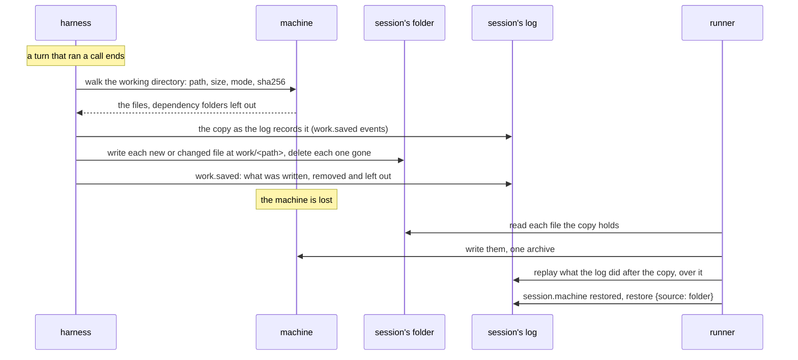

# A working directory kept in the session's folder

## Overview

A session's working directory lives on its machine and nowhere else.
When the machine is lost (a sandbox killed, a sandbox that reached the
end of its lifetime, or a fork's first machine), the working directory
is rebuilt from the session's log
([[065-a-working-directory-rebuilt-from-the-log]]): the files the
`write` and `edit` tools wrote, the files an answer showed or linked,
and the files read in full come back. A file a command made does not:
a build's output, generated data, a downloaded file. A session lost
seventy minutes of a command's work this way, and a site an agent built
stays on a machine that is deleted a day after it opened.

A session that keeps its files in a folder of a files store
([[068-a-sessions-files-in-a-files-store]]) has a place that outlives
its machines. This spec keeps the working directory there:

> Decided on 2026-10-12: the working directory keeps the latest state
> only, no snapshot per turn, and it lives in the conversation's [files
> store] folder. Installed dependencies are not kept: dependency
> folders stay out, and the model is told the machine is new and
> reinstalls from manifests.

| Capability | What it means |
|---|---|
| a copy of the working directory | at the end of each turn that changed files, the files of the working directory are written under `work/` of the session's folder, each at its path, the latest state alone |
| a new machine restored | a machine made new for the session, and a fork's first, gets the copy first, then what the log holds that the copy does not |
| a fork's copy | a fork copies its parent's `work/` into its own folder on the server, and its first machine is restored from it |
| a person's own files | the copy is plain files a person opens and downloads in the files service, beside the conversation's attachments and results |

A session with no folder, and a runner with no files store, run exactly
as before.

## Current state

- A session's folder holds `attachments/<event id>/<name>` and
  `results/<turn>/<path>`, each written once by the session's own token
  ([[068-a-sessions-files-in-a-files-store]]).
- A machine that says its open made it new (`machine.Recovering`) gets
  what the log holds of its working directory, recorded as
  `session.machine` reason `restored` with `restore {source: "log"}`
  ([[065-a-working-directory-rebuilt-from-the-log]]).
- A session with no repository keeps no checkpoint that outlives its
  sandbox ([[034-checkpoints-and-rewind]]).
- The session's token may read, write, upload and delete inside its own
  folder; it may not list it. An installation's authorizer may say
  that a write there keeps no version and a delete keeps nothing in a
  trash.

## Design



### The format: plain files

Each file of the working directory is one file of the folder at
`work/<path>`, `<path>` its path relative to the working directory, with
the media type its name and leading bytes give and the bytes it had at
the turn's end. A file that changed is written over in place; a file
the working directory no longer holds is deleted. Nothing of an earlier
turn is kept.

| Choice | Picked | Weighed against |
|---|---|---|
| The copy's form | plain files under `work/` | one archive of the directory: every turn rewrites it whole, or a chain of archives that adds what changed (the bundles of the unmerged design that kept checkpoints among a session's blobs), and a person opens no file of it without downloading all of it |
| What a turn writes | the files whose bytes differ from the copy's, by digest | the whole directory: a turn that changed one file would write every one |

### What the copy is: `work.saved`

The session's token cannot list its folder, so the copy is recorded in
the session's log. Each turn end that wrote, removed or left out a file
appends one `work.saved`, in the batch of the `session.status` that
ends the turn, before it:

```json
{"type": "work.saved", "turn": 7, "payload": {
  "covers": 184,
  "written": [{"path": "dist/index.html", "size": 2048, "mode": 420,
               "sha256": "9b74c9897bac770ffc029102a200c5de3f1d1e2c4a5b6c7d8e9f0a1b2c3d4e5f"}],
  "removed": ["notes-old.md"],
  "unsaved": ["data/rows.csv"],
  "deferred": 3,
  "skipped": 1,
  "skipped_files": [{"path": "data/raw.parquet", "reason": "too_large"}],
  "held": {"files": 412, "bytes": 18234011}}}
```

| Member | Meaning |
|---|---|
| `covers` | the last sequence of the log the turn end had read when it walked the working directory: the copy holds each of its files as it was after every event up to there |
| `written` | the files written this time, new or changed, each `{path, size, mode, sha256}`; `mode` is the file's permission bits, `sha256` the hex digest of its bytes |
| `removed` | the paths the copy no longer holds: gone from the working directory, or past the copy's bounds now. Their files are deleted from the folder |
| `unsaved` | the paths whose bytes changed and were not written this time; the copy no longer vouches for them, and the folder may still hold an older file at the path, written over or deleted later |
| `deferred` | how many changed files this turn's bounds left for a later turn |
| `skipped`, `skipped_files` | how many files the copy leaves out as it stands, and the first `MaxRestoreNames` of them, each `{path, reason}`, reason `too_large` for a file past `MaxWorkFileBytes` and `limit` for one past the copy's bounds |
| `held` | the files and bytes the copy holds after this save |
| `failed` | `{code, detail}` when the save stopped short: `machine_unavailable` when the working directory could not be walked, `files_unavailable` when the files store did not take a write or a delete. What was written before it is recorded |
| `whole`, `from` | set on the `work.saved` a fork appends: `written` is then every file of the copy and replaces what earlier events recorded, and `from` is the session whose copy it is |

The copy as it stands is the fold of every `work.saved` of the log in
order (`session.CopyOf`): each written file replaces its path's, each
removed and unsaved path leaves it, and a `whole` one starts again. A
save whose walk failed changes nothing of the copy but that a later turn
end saves again.

A digest is written as bare hex, as the tools' results write a file's
`sha256`, and not as `sha256:<hex>`: a store reads every string of that
form in a payload as a blob of the session, and a copy's files are no
blobs. `work.saved` is a record, not content: it is not redactable, the
fold renders nothing of it, and a search does not read it.

### What is kept, and what is left out

Every regular file under the working directory is kept, except:

| Left out | Why |
|---|---|
| a directory named in `session.WorkLeftOut`, at any depth: `.git`, `node_modules`, `bower_components`, `.venv`, `venv`, `__pycache__`, `.pytest_cache`, `.mypy_cache`, `.ruff_cache`, `.tox`, `.nox`, `.cache`, `.npm`, `.pnpm-store`, `.yarn`, `.gradle`, `.m2`, `target`, `.terraform`, `.turbo`, `.parcel-cache` | installed dependencies and caches a command makes again from the project's manifests, and every repository's history: a repository's own files are kept as plain files, and commits that were not pushed are not |
| what the credential deny-list names ([[009-machines]]) | no tool reads it |
| a symbolic link, a device, a pipe, a socket, and an empty directory | a files store holds files |
| a file past `MaxWorkFileBytes` | skipped `too_large` |
| a file past the copy's files or bytes, in path order | skipped `limit` |

A build's output is kept: `dist`, `build`, `out` and `.next` are not
left out, since a site an agent built is what a person wants back.

### Bounds

| Bound | Value | Constant |
|---|---|---|
| bytes of one file | 33,554,432 (32 MiB) | `session.MaxWorkFileBytes` |
| files the copy holds | 5,000 | `session.MaxWorkFiles` |
| bytes the copy holds | 268,435,456 (256 MiB) | `session.MaxWorkBytes` |
| files one turn end writes | 1,000 | `session.MaxWorkTurnFiles` |
| bytes one turn end writes | 67,108,864 (64 MiB) | `session.MaxWorkTurnBytes` |
| files a walk lists | 20,000, four times the copy's | `harness.maxWalked` |
| one turn end's writing | 124 seconds: `MaxWorkTurnBytes` at 1 MiB a second, and a minute | computed |
| one restore's writing | 320 seconds: `MaxWorkBytes` and `tools.MaxRebuiltBytes` at 1 MiB a second | computed |

The walk hashes files in walk order, each directory's entries by name,
until the copy's bounds are reached, so a turn end never hashes more
than `MaxWorkBytes`. A walk cut at its listing bound removes from the
copy no path that sorts after the last one it listed. A turn end
writes the changed files in path order within its own bounds; the rest
are `deferred` and written by a later turn end. The copy's bound on
files is half of a files API's bound on one folder copy, 10,000 objects.

### When a turn end writes

At the end of a turn of the session's own thread, the harness writes the
copy when all of these hold:

- the session's runner has a files store (`harness.Config.Files`);
- the turn's machine is open, says what its open made of it
  (`machine.Recovering`), and walks its working directory
  (`machine.Walker`), as a Cella sandbox does;
- a call ran since the last `work.saved`, or the last one deferred a
  file or failed.

A turn that only talked opens no machine and writes nothing. A turn
whose files equal the copy's appends nothing.

### Failure

A turn end never fails because of the copy. A walk the machine does not
answer, and a write or a delete the files store refuses for anything but
the file's size, stop the save: `work.saved` records what was written,
and `failed` why. A write refused for the file's size is the file's
`too_large`. A machine lost under the turn writes nothing and records
nothing: the loss is recorded where it happened ([[009-machines]]).

### Restore

When a machine says its open made it new, and the session's log
records a machine of its own before it, or the machine is a fork's
first ([[065-a-working-directory-rebuilt-from-the-log]]), and the
session has a folder, a runner with a files store, and a copy, the
runner restores before the call that opened the machine runs:

1. **The copy.** Every file the copy holds is read from `work/<path>`
   of the session's own folder, with the session's token, and written
   into the working directory with its mode, in one archive where the
   machine takes one. A file the folder no longer holds is not written;
   the log may give it back.
2. **The log.** The replay of
   [[065-a-working-directory-rebuilt-from-the-log]] runs over the whole
   log with the copy standing in at its `covers`: there, each path the
   copy holds takes the copy's file; a path the copy does not hold keeps
   what the log gave it, unless a `work.saved` after the log last wrote
   it removed it, since a command deleted it then; and a path whose
   latest write or edit was redacted is not taken from the copy either.
   Each event after `covers` applies as before, an `edit` to the copy's
   bytes, and a file the log changed keeps the copy's mode. The copy's
   files and the log's go to the machine in one archive; a file the copy
   holds that the folder no longer has is then the log's, where the log
   gives one, in a second.
3. **The record.** `session.machine` reason `restored` with
   `restore {source: "folder", copy, ...}`:

```json
{"type": "session.machine", "payload": {
  "machine": {"kind": "cella", "id": "sbx_01J9Z3Q4W8KX6T0M2V5N7R1B3C", "workdir": "/workspace"},
  "reason": "restored",
  "restore": {"source": "folder",
              "copy": {"files": 412, "bytes": 18234011, "turn": 7,
                       "skipped": 1, "skipped_files": [{"path": "data/raw.parquet", "reason": "too_large"}]},
              "files": 2, "bytes": 1840, "unverified": 0, "omitted": 0, "commands": 3,
              "paths": ["notes.md", "src/app.py"]}}}
```

| Member | Meaning beside `source: "folder"` |
|---|---|
| `copy.files`, `copy.bytes` | the files written from the copy, and their sizes together |
| `copy.turn` | the turn whose end saved the copy last; absent on a fork's copy |
| `copy.inherited` | true on a fork's copy: its parent's latest, which may hold changes made after the point the fork continues from |
| `copy.skipped`, `copy.skipped_files` | what the latest save left out, as `work.saved` names it |
| `files`, `bytes`, `paths` | the files the log wrote over the copy or beside it |
| `unverified`, `omitted`, `commands` and their lists | as for a rebuild from the log, counted from the copy: `commands` is how many commands ran after it; `omitted_files` reason `copy_unavailable` is a file the copy holds that the folder no longer had and the log could not give back |

A fork whose first machine was given its fork point's checkpoint
([[034-checkpoints-and-rewind]]) takes no copy and no replay, as
[[065-a-working-directory-rebuilt-from-the-log]] has it: the checkpoint
holds every file.

A copy that cannot be written at all, a read the files store refuses or
an archive the machine does not take, leaves the machine to the rebuild
from the log alone, recorded as before with `source: "log"`, and with
`copy {failed}`, a developer's detail of why.

### A fork

A fork whose parent records a copy, and whose own allow names a folder,
copies `work` from the parent's folder into its own on the server, with
its own token, beside the other folders it copies
([[068-a-sessions-files-in-a-files-store]]). Its log gains a
`work.saved` after its copied events, `whole` and `from` set, `written`
the parent's copy as it stands when the fork is made, and `covers` the
smaller of the parent's `covers` and the fork point: the copied events up
to the fork point are its past, and what the parent did after the fork
point is in the copy and not in the fork's log. A fork starts from its
parent's latest working directory, not from the fork point's, as its
first machine is restored from that copy.

| The fork | Outcome |
|---|---|
| its parent's `work` holds nothing | skipped; the files the event names are not found at the restore and the log may give them back |
| the copy is refused | the fork is `files_unavailable` and is not made, as for the other folders |
| its allow names no folder | no copy; its first machine is rebuilt from its log, as before |
| it is a fork before the first message | no copy: it continues nothing, and its first machine starts empty, as before |

### What the model reads

The fold renders a `restore` with `source: "folder"` into the session's
own thread where it happened, from
`prompts/transcript/machine-work-restored-v1.md`:

```
The working directory is on a new machine and was restored from the copy this conversation keeps of it, as it was saved at the end of turn 7: 412 files.
Then these were brought up to date from this conversation's record, from what the write and edit tools wrote, the files an answer showed or linked, and files that were read in full after that:
- notes.md
- src/app.py
These were too large for the copy, or past what it holds, so they are missing:
- data/raw.parquet
The copy does not keep installed dependencies and caches (node_modules, bower_components, .venv, ...), the history of any repository (.git), files larger than 32 MiB, or running processes. 3 commands ran after the copy was saved; what they made or changed since is missing. Reinstall dependencies from the project's manifests, such as package.json, requirements.txt or pyproject.toml, before you run anything that needs them, and tell the person what is back and what is not.
```

The list of left-out directories is `session.WorkLeftOut` but `.git`,
which the note names apart. A fork's copy reads "as the conversation
this one continues last saved it, so it may hold changes made after the
point this one continues from".

A rebuild from the log alone reads as before.

### Who reads the copy, and what a redaction does

The copy's files are files of the session's folder: whoever the
installation lets read the folder reads them, and the blob route does
not answer them, since no event names them by digest. A redaction does
not change the working directory, so it does not change the copy: a
file a redacted call wrote stays on the machine and in the copy until
the working directory no longer holds it. A restore does not take a
file from the copy whose latest write or edit was redacted, as the log
does not rebuild one, and the next turn end then deletes it from the
folder.

### Decisions

| Choice | Picked | Weighed against |
|---|---|---|
| Where the copy is | `work/` of the session's folder | a blob store outside the session database: a person cannot open it, and an installation without one keeps nothing |
| What records the copy | `work.saved` in the log | a listing of the folder at each turn end: the session's token is not given one, and a restore would read an unbounded listing; a manifest file in the folder: a second record a person sees and a crash can leave behind the files |
| Each `work.saved` | what changed | the whole list each turn: the log would grow by the whole copy every turn |
| When | the end of a turn that ran a call | each step: a long turn would write the same files many times |
| Hashing | on the machine, by the helper | reading every file to the runner each turn |
| What a restore takes first | the copy, then the log after it | the log alone: a command's files are lost; the copy alone: the writes of a turn that had not ended are lost |
| A fork's copy | the parent's latest | the fork point's: the copy keeps no turn's but the latest |
| A copy a fork cannot make | the fork is refused | made without it: the fork's record would name files its folder does not hold, and the person would not know |

### What the installation's authorizer admits

The copy is written with the session's own token, as the folder's other
files are ([[068-a-sessions-files-in-a-files-store]]), so an
installation's authorizer admits, for a session's token inside its own
folder: a write in place of a file there (`file.write`, a `PUT` with no
`If-None-Match`, and an upload's completion with none); a delete of one
file (`file.delete`, `permanent=1`); and, for a fork, a copy of its
parent's `work` (`file.write` with the parent's folder as the source).
It is not asked for a listing. An authorizer that answers
`versions: false` on those writes keeps the latest state alone, and one
that keeps versions keeps one for each overwrite. A session whose
token is refused, as one that ended, keeps no copy, and its turn ends
as before.

## Not in this spec

Listing the folder. Keeping a repository's history, or an empty
directory, or a symbolic link. A rewind from the copy
([[034-checkpoints-and-rewind]]). A person changing the copy in the
files service and the machine taking the change. Deleting the copy when
the working directory is emptied by a person's request. A session
without a folder.

## Acceptance criteria

| # | Criterion | Test | State |
|---|---|---|---|
| 1 | `work/` refs are checked; the copy is the fold of `work.saved` events, a `whole` one starting again and a failed walk changing nothing; its digests are no blobs of the session; the event is known, not redactable, not searched, and the fold renders nothing of it | `session.TestTheCopyIsTheFoldOfItsSaves`, `session.TestARefIsAPlaceInTheFolder` | built |
| 2 | The walk lists every regular file under the working directory with its size, mode and digest, in walk order, leaving out a left-out directory at any depth, the deny-list, links and non-regular files, hashing nothing past the per-file bound or the copy's bounds, and stops at its listing bound and says so; a sandbox walks with the helper | `machine.TestAWalkListsTheWorkingDirectory`, `cmd/topos-machine.TestTheWalkMode`, `machine/cella.TestASandboxWalksItsWorkingDirectory` | built |
| 3 | A turn end that ran a call writes the new and changed files at `work/<path>` with their modes and media types, deletes the removed ones, appends `work.saved` before the closing status, appends nothing for a turn that ran no call or an unchanged directory, holds to the turn's and the copy's bounds with the rest deferred and written by the next turn end, records a mode changed alone with no write, skips a file past the bound and deletes it once it grows past it, and records a failed walk, a refused write and a refused delete without failing the turn; a session with no files store or a machine that does not walk keeps no copy | `harness.TestATurnEndKeepsTheWorkingDirectory`, `harness.TestTheCopyHoldsToItsBounds`, `harness.TestACopyThatCannotBeWrittenIsRecorded` | built |
| 4 | The replay with a copy takes the copy at `covers`, the log's later events over it, an edit applied to the copy's bytes, a file removed after the log's write left out and one written again after the removal back, a redacted write not taken from the copy, the commands counted from `covers`, and the copy again after a later replacement | `harness/tools.TestRebuildOverACopy` | built |
| 5 | A machine made new for a session with a copy is restored from it, files and modes, a dependency directory absent, then from the log for a file the copy does not hold, and recorded `restored` with `source: "folder"`; a file the folder no longer holds is omitted `copy_unavailable`; the next turn end writes what the copy lacked and deletes what it holds that the directory does not; a copy that cannot be read leaves the log alone with `copy.failed` | `runner.TestANewMachineIsRestoredFromTheCopy`, `runner.TestACopyThatCannotBeReadLeavesTheLog` | built |
| 6 | The model reads what came back from the copy and from the log, what was left out, what the copy does not keep, and that dependencies are reinstalled from manifests; a copy that could not be written reads as a rebuild from the log | `session.TestARestoreFromTheCopyIsSaid`, `prompts.TestEveryTextRendersItsCurrentBytes` | built |
| 7 | A fork copies its parent's `work` on the server with its own token and appends, after its copied events and before a message it is sent, a `whole` `work.saved` of the parent's latest copy with `covers` at most the fork point; a fork before the first message and a fork with no folder copy none; a parent whose `work/` holds nothing is skipped; a refused copy leaves no fork | `internal/server.TestAForkCopiesItsParentsWorkingDirectory` | built |
| 8 | Over the stub Cella and the stub files API: a command's file and its mode are in `work/` after the turn, written with the session's token, a dependency directory left out; the sandbox fails and is replaced, and the new sandbox has them back before its first command, recorded `restored` from the folder, and the model reads it | `internal/hosted.TestASandboxIsRestoredFromTheSessionsFolder` | built |
| 9 | The OpenAPI document states `work.saved`, the folder's `work/` and the restore from the folder | `internal/server.TestTheDocumentStatesKeptImages`, `internal/server.TestOpenAPIIsGenerated` | built |

## Outcome

Built on 2026-10-13, in no release yet, and run against the stub Cella
and the stub files API alone, not against a Cella installation or an
installation's files service. Every criterion has its test. Where the
build differs from the design as first written, or adds to it:

- **The restore writes one archive**, the copy's files and the log's
  together, and a second only for a file the folder no longer held that
  the log gives back.
- **A copy that cannot be written** leaves the log's rebuild, and its
  record says why in `copy.failed`, since the runner logs nothing of its
  own.
- **A file the log changed after the copy keeps the copy's mode**, so an
  edited script stays executable.
- **A walk cut at its listing bound** removes nothing it did not reach.
- **The whole `work.saved` of a fork** names the paths its parent's
  folder may hold an older file at, in `unsaved`, since the fork's copy
  holds them too and a later save of the fork deletes or writes over
  them. It is appended with turn 0, which is why a fork's restore record
  names no `copy.turn`.
- **A session with a repository delivered into its working directory**
  keeps that repository's files in the copy as plain files, with no
  history; its checkpoints at the git host are unchanged.

Open: a run against a real files service and Cella; a person's change of
the copy in the files service is not taken by the machine; the copy of
a session whose files store refuses its token, as after the session's
end, is not written.
