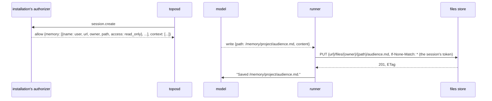

# Memory folders the file tools reach

## Overview

A person who works with an agent over many sessions tells it the same
things again: a preference, a name, a decision. An installation that
keeps a person's files in a files store
([[068-a-sessions-files-in-a-files-store]]) can keep what its agents
should remember there too, as files: one Markdown file per memory and an
index, in a folder per person and a folder per group of sessions. What
the core lacks is a way for a session to reach such a folder.

This spec lets an authorizer's allow of `session.create` and
`session.fork` name **memory folders**: folders of a files store, each
with a name and an access. The session's file tools reach each one at
`/memory/<name>/`. The runner carries every call to the files store with
the session's own token, so no machine holds a credential, a call that
reaches memory alone opens no machine, and a session that only talks and
remembers never has one. Every write is conditional on the version the
session last read, so two sessions writing one folder lose nothing.

The core fixes how a folder is reached, bounded and shown. Which folders
a session gets, what a memory says and what is loaded at the start are
the installation's: its allow names the folders and puts what the session
should read first in a `context` part ([[058-what-a-create-allow-attaches]]).

## Current state

- An allow may name `folder`, the session's own folder in a files store,
  which its attachments and kept files are written to with the session's
  token for `TOPOS_FILES_AUDIENCE` (`internal/filestore`, spec 068).
  Nothing reaches any other folder.
- The file tools act through `Call.Machine`; the harness opens a machine
  opened on demand before a call of any tool with an effect
  (`opensMachine` in `harness/harness.go`), and starts it when a
  response begins such a call.
- `write` and `edit` hold to the current-content rule of [[008-tools]]: an
  existing file is overwritten only when its hash is the one the thread
  last recorded. The machine's `WriteFile` takes no precondition.
- `context/attachments-v1` names a session's attached apps on every
  request.
- Spec 020's memory stores and spec 060's memory tool are drafted and not
  built. This spec supersedes both (Decisions).

## Design



### The member

```json
{"memory": [
  {"name": "user", "url": "https://storage.example.com/v1", "owner": "https://issuer.example|9ab3",
   "path": "files/memory/you", "access": "read_only"},
  {"name": "project", "url": "https://storage.example.com/v1", "owner": "https://issuer.example|9ab3",
   "path": "files/memory/projects/p1", "access": "read_write"}
]}
```

| Field | Rule |
|---|---|
| `name` | `^[a-z][a-z0-9-]{0,31}$`, unique among the folders; the folder is `/memory/<name>/` |
| `url` | the files API's root, under which `files/{owner}/{path}` is served, as spec 068's `folder.url` |
| `owner` | the space, 1 to 512 bytes with no control character, as spec 068's |
| `path` | relative, `/` separated, no empty or `..` segment, at most 512 bytes |
| `access` | `read_only` or `read_write` |

| Bound | Value | Holds |
|---|---|---|
| `session.MaxMemoryFolders` | 4 | the folders of one session |
| `memory.MaxFileBytes` | 1 MiB | one file written or read through a folder; an installation bounds lower with a refusal |
| `memory.MaxListed` | 2000 | the files a listing, a glob or a grep reads in one folder; past it the result says the rest were not read |

An allow past a bound or breaking a rule does not decode, and the create
is refused `authorizer_unavailable` naming the member, as every member of
spec 058. An allow that names `memory` on an installation without
`TOPOS_FILES_AUDIENCE` is refused the same way: the runner has no
credential to reach the folders with.

### Where it is kept

`Session.Memory []MemoryFolder`, from the allow, beside `Folder`. No event
changes it. A fork's are its own allow's. The session's object in the API
carries `memory: [{name, access}]`, so a client knows a session has memory
without the store's address.

### The paths

| Path | Is |
|---|---|
| `/memory` | a directory whose entries are the session's folders |
| `/memory/<name>` | the folder |
| `/memory/<name>/<rel>` | `{path}/<rel>` in the folder's space |

A relative path resolves against the working directory, as always, and is
never memory. A path under `/memory/` that names no folder of the session
is `no such file`.

### Who carries a call

The tools `read`, `write`, `edit`, `glob` and `grep` name their paths
(`tools.Pather`). A call whose every path is under `/memory/` runs on the
session's **memory machine**, a `machine.Machine` the runner builds from
the session's folders; any other call runs on the session's machine as
today. So:

- the harness neither opens nor starts the session's machine for a call
  on the memory machine;
- the session's machine is unchanged, with every optional interface it
  has;
- `bash` runs on the session's machine and does not see `/memory/`.

At the start of a response's tool call the harness cannot yet read the
call's path, so in a session with memory folders it does not start the
machine for a call of those five tools; it opens it, if the call needs
it, when the call runs. `bash` and every other tool start it as today.

The memory machine's operations:

| Operation | Request |
|---|---|
| `ReadFile` | `GET`; the `ETag` is kept for the path |
| `Stat` | `HEAD` for a file; a folder and `/memory` are directories |
| `List` | `GET ?list=1` under the folder, paged, at most `memory.MaxListed` files, with the directories the paths imply |
| `WriteFile` with content | `PUT` with `If-Match` on the kept `ETag`, or `If-None-Match: *` for a path last seen absent or never seen |
| `WriteFile` empty | `DELETE` with `If-Match` on the kept `ETag`: the file is forgotten |
| `Remove` | `DELETE` with `If-Match` |
| `Rename` | refused: a memory file is not moved |
| `Search` | the listing, then each file read, cached by checksum for the session, and matched as the Go-native search matches |
| `Exec`, `ExecStream` | refused: commands run on the session's machine |

A folder whose access is `read_only` refuses `WriteFile`, `Remove` and
`Rename` before any request. Every request carries the session's token
for `TOPOS_FILES_AUDIENCE`, workload `session`, as spec 068's do; a
redirect to a presigned address is followed without it.

### The write

The current-content rule of [[008-tools]] still holds first: the tool
reads an existing file before it overwrites it, through the memory
machine, which keeps the `ETag` of that read. The write then sends
`If-Match` with it, so a file another session changed between the read
and the write is refused `412` and nothing is overwritten. The tool's
result is the rule's own "changed since you read it" text, and the model
reads the file again.

`write` with empty content to a path under `/memory/` forgets the file.
The result reads "Forgot /memory/user/trains.md." Its meta carries
`memory: {folder, path, action}`, with `action` `saved` or `forgotten`,
so a client can show that memory changed.

### Refusals and failures

| The store answers | The tool's result |
|---|---|
| `412` | the current-content rule's changed text |
| a 4xx with the error envelope | its `message`, the installation's sentence, which the model reads; its `code` in the result's meta as `refusal` |
| a 5xx, a timeout, a body that does not decode | an error: "Memory could not be reached: <detail>." |

### What the model is told

`context/attachments-v2`, rendered from the session's header on every
request, adds the folders to the attachments block:

```
<attachments>
Memory folders, kept across sessions. read, write, edit, glob and grep reach them and commands do not; write a file empty to forget it:
- /memory/user/ (read only)
- /memory/project/ (read and write)
</attachments>
```

The text is the core's and names no installation. What a memory is for,
its format, and the index the session reads first are the installation's
`context` part.

### How a call is decided

A call whose every path is under `/memory/` scores with the feature
`memory` at 0.1 in place of the tool's own features ([[012-permissions-and-approvals]]):
allowed in `confirm` and `progressive` with the reason "a memory the
person can review", and blocked in `plan`, as every write. An
installation that wants each one asked names `memory` in
`always_confirm`. The person reviews and removes every memory through the
installation.

## Decisions

| Decision | Chosen | Alternatives and why not |
|---|---|---|
| The shape | folders of a files store, reached by the file tools | spec 020's store resource synced into the machine at turn boundaries: a machine for every memory write, conflict copies, and on a person's own computer a write into their real disk; spec 060's tool over a service: a new API where the file tools do, and a contract for one sentence at a time |
| Who carries a call | the runner, on a memory machine of its own | a mount in the machine: a credential or a sync in the machine |
| Which calls | a call whose every path is under `/memory/` | a wrapper over the session's machine: it would hide the machine's optional interfaces |
| The precondition | the store's `ETag` the memory machine kept, under the tool's own rule | the tool's rule alone: a write could land over another session's change made between the read and the write |
| Forgetting | an empty write | a delete tool: one more tool for one action; `bash rm`: the folders are not on the machine |
| Who names the folders | the allow | the agent's definition: which of a person's things a session reaches is the authorizer's |
| What is read at the start | the installation's `context` part | a read by the runner at the first request: a log event per session so every runner renders one prompt, and the core would learn a format |

## Roll order

1. The installation's authorizer admits a session's token in the folders
   it will name, and sends `memory` only to a core whose release notes
   say it reads it; an older core ignores it as an unknown member.
2. This release: the member, the memory machine, the routing, the
   template, the scoring.
3. The installation sends `memory`.

## Not in this spec

What a memory says, its format, its index and what a session reads at its
start: the installation's. Who may write which folder: the authorizer's.
Searching by meaning. Specs 020 and 060, which this supersedes.

## Acceptance criteria

| Criterion | Test that proves it | State |
|---|---|---|
| The member is decoded with its rules and bounds and kept on the session; one past a bound, breaking a rule, or with no `TOPOS_FILES_AUDIENCE` refuses the create `authorizer_unavailable` naming it; a fork's are its own allow's | `authorizer.TestTheMemoryMember`, `internal/server.TestACreateKeepsTheMemoryFolders` | not built |
| Over the files store stub: a read keeps the `ETag`; a new file is written `If-None-Match: *` and an overwrite `If-Match`; a `412` is the changed text and overwrites nothing; an empty write forgets with `If-Match`; a rename and a command are refused; a `read_only` folder refuses a write before any request | `memory.TestTheMemoryMachine` | not built |
| A call whose every path is under `/memory/` runs on the memory machine and opens no machine; any other call opens it as before; a session with memory folders does not start its machine for a file tool at the response's start | `harness.TestAMemoryCallOpensNoMachine` | not built |
| `glob` and `grep` over a folder find its files and lines, past `memory.MaxListed` say so, and read a file once per checksum | `memory.TestGlobAndGrepInAFolder` | not built |
| The attachments block names each folder and its access on every request, unchanged across turns | `harness.TestTheAttachmentsBlockNamesMemory` | not built |
| A memory call scores with the feature `memory`, is allowed in `confirm` and `progressive`, blocked in `plan`, and asked when `always_confirm` names it | `harness.TestTheMemoryVerdict` | not built |
| No token for the files store reaches the machine | `internal/hosted.TestNoMemoryCredentialInMachine` | not built |
| A session saves a memory that a second session with the same folder reads, end to end | `test/e2e.TestMemoryAcrossSessions` over the files store stub | not built |
