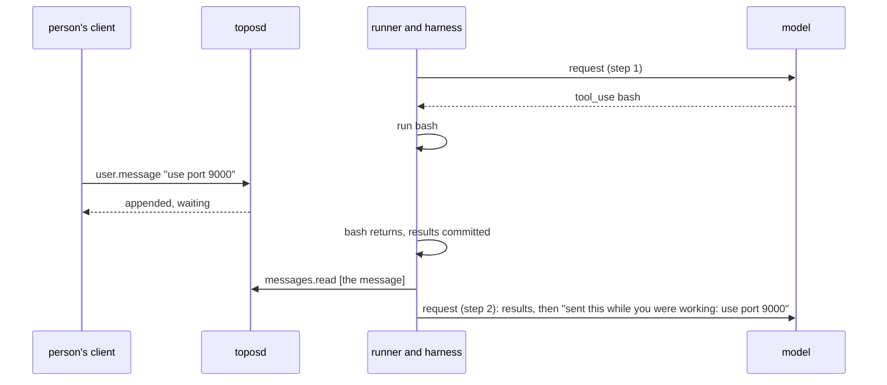

# Messages sent while a turn runs

## Overview

A person who watches an agent work often has more to say before it
finishes: a correction, a detail they forgot, a change of mind. Today
the server takes such a message and the harness reads it whenever its
next request is built, which happens to work between two steps of a
turn but has three faults. The model is never told the message arrived
during its work, so it reads a correction as part of the original ask.
A message that arrives while a request is in flight is folded before
that request's answer, so the next request tells the model it had read
the message when it answered. And a trigger's firing or a wake's note
that arrives mid-turn steers the turn exactly as the person would.

This spec makes the behavior a designed one, after the message queue
of Claude Code, the agent client this core's clients are measured
against. A person's message sent while a turn runs is read at the next
step, at the place it was read, and marked as sent during the work. A
message that is not a person's waits for the turn's end and starts the
next one. A person who cannot wait sends with **send now**: running
commands move to the background, anything else still running after a
short grace is cut, and the message is read at once. A message not yet
read can be **withdrawn**, which is how a client lets a person edit
what they queued. Every state a client shows (waiting, read, withdrawn)
is an event in the log, so every client shows the same.

## Current state

- The send route appends a `user.message` whatever the session's
  status; only an ended session refuses it (`internal/server/events.go`,
  `sendEvent`).
- Each step folds the whole log (`stepOnce` in `harness/harness.go`),
  and `commit` adds what others appended, so a message appended while
  the step's calls ran is in the next request, after the step's tool
  results.
- A message appended while a request is in flight is appended before
  that request's `model.request` and `agent.message`, so the next fold
  renders it before the answer the model gave without it.
- A turn whose last step saw no message ends with `Outcome.Pending`
  when a message arrived after its last fold (`turn.pending`), and the
  runner starts the next turn without releasing ([[016-runners]]).
- Spec 016 says a message that arrives during a turn waits for that
  turn's end. The code reads it at the next step; the spec is wrong.
- `user.interrupt` cuts the step: the in-flight request is canceled,
  running calls get `canceled` results, and the turn ends `interrupted`
  ([[005-harness-loop]]).
- A foreground `bash` command that starts a server is moved to the
  background after `BashServerGrace` ([[045-a-server-cannot-hold-a-turn]]):
  `machine.ExecRequest.ServerGrace` on the host machine and through
  `topos-machine run -server-grace` in a sandbox, with the result
  `results/bash/moved-v1`.
- A trigger's firing and a wake append their `user.message` to a
  running session as a person's would (`internal/server/triggers.go`,
  `internal/server/wakes.go`).
- `model.request` records `fold_seq`, the log's last sequence when the
  request was built; it is appended once the response has arrived.

## Design

### Waiting messages

A **waiting message** is a `user.message` of the session's own thread
appended while that thread's turn runs: after a `session.status`
`running` and before the status that closes that turn. A message
appended while the session is idle is not waiting; it starts a turn as
before, and nothing below changes for it.

| The waiting message's sender | Read by |
|---|---|
| a person (`sender.kind` `person`) | the next request of any turn, the one it arrived in included |
| a trigger's firing or a wake (`sender.kind` `trigger`), and every other sender that is not a person | the first request of a later turn; never by the turn it arrived in |

A turn that ends while a person's or a trigger's waiting message is
unread and not withdrawn reports `Outcome.Pending`, and the runner
starts the next turn from it without releasing. `session.HasPendingInput`
holds for such a log too, so a runner that stopped between the two
turns leaves the session to the next claim ([[016-runners]]). A session
whose `EndOnIdle` would end it after the turn does not end while such a
message is unread: the next turn reads it first.

Neither holds while the session waits for a person: an ask nobody
confirmed, a question nothing closed, or a client's call without its
result. A held message is no pending input then, since the runner could
do nothing with it but find the session waiting again; the turn the
person's answer starts reads it. A message that is not a person's never
closes a question or denies an ask, as today
([[012-permissions-and-approvals]], [[039-questions]]).

A message that starts no turn, such as another session's
([[092-a-persons-sessions-that-see-each-others-work]]), is held as a
trigger's is, is read by the next turn whatever starts it, and is never
pending input.

At the first request of a later turn, every waiting message is read, a
person's and the others' together, in the order they arrived.

### `messages.read`

Before the first request whose fold takes in a waiting message, the
harness appends `messages.read`:

| Field | Value |
|---|---|
| `event_ids` | the ids of the waiting messages this request is the first to read, in sequence order |

The harness names the messages from the log it has seen, appends the
event, and folds the log the append returns, so a message withdrawn in
between is left out ([Withdrawing a message](#withdrawing-a-message)).
`messages.read` is written by the runner, is never sent by a client,
and is the one record that a waiting message was read.

Every `model.request` the harness writes from this spec on carries
`names_reads` `true`. A request of the session's own thread without it
was written before, named nothing, and read every waiting message its
`fold_seq` reaches; such a message is read, and renders where it stands.

### The transcript

The fold renders a message a `messages.read` names at that event's
place, in the order it names them, and not at the message's own place.
Every rule that reads a message's place (a compaction's range, a
summary's cover, the cache marks) reads the event's. A message a
request without `names_reads` read renders at its own place, as before,
so a log written before this spec folds byte for byte as it did. A
waiting message nothing read yet, whoever sent it, and a withdrawn one
render nowhere.

A message read by a request of the turn it arrived in is led by one
text block, before its content and in place of `transcript/sender-v1`:

| Template | Text | Leads |
|---|---|---|
| `transcript/while-working-v1` | `{{or .Name .Subject "The person"}} sent this while you were working:` | a person's message read by the turn it arrived in |
| `transcript/sent-now-v1` | `{{or .Name .Subject "The person"}} stopped your work to send this:` | a `send_now` message read by the turn after the one its send cut |

Any other message is rendered as it is today.

### Send now

`user.message` takes `send_now`, a boolean, `false` when absent. On an
idle session it changes nothing. While a turn runs, the runner's watch
of the log, which already acts on `user.interrupt`, signals the harness.
The harness acts on a `send_now` message the step's request did not
read, one that arrived after the last `messages.read` the step's
request was built after, by what the step is doing when the signal
comes or once the step reaches it:

| The step is | The harness |
|---|---|
| building its request (folding, compacting, writing a message's files) | nothing yet: a request built after the message reads it; one built before is in flight next, and the row below applies |
| waiting for the model's response | cancels the request at once, as an interrupt does, and ends the turn `interrupted` with `detail` `send_now` |
| running calls | asks every running `bash` command to move to the background, waits up to `harness.SendNowGrace` for every call to return, then cancels the calls still running as an interrupt does |

When every call returns within the grace, the step commits as any step
does, and the next request of the same turn reads the message, led by
`transcript/while-working-v1`. When a call is canceled, the turn ends
`interrupted` with `detail` `send_now`, reports `Outcome.Pending`, and
the next turn reads the message, led by `transcript/sent-now-v1`.

| Bound | Value | Why |
|---|---|---|
| `harness.SendNowGrace` | 1 s | a command moved in a sandbox answers over its exec session, and a short read finishes; Claude Code waits about 400 ms in one process |

A command moved by send now keeps running as a job, as a moved server
does, and its call is answered `ok` with what it wrote so far and
`results/bash/moved-now-v1`:

> Still running when a message was sent to be read now, so it was moved
> to the background as pid {{.PID}} and keeps running. Its output so far
> is above; what it writes from now on goes to {{.Log}}. Read the log
> with read, and stop it with bash: kill -TERM -{{.PID}}.

`machine.ExecRequest` takes `MoveNow`, a channel: once it is closed, a
foreground command still running moves to the background as
`ServerGrace` moves a server, whatever it listens on, and the result has
`Moved` set and no `Ports`. The host machine moves it in process; a
sandbox's `topos-machine run` moves it on a new frame, `m`, which the
Cella machine sends. A machine that cannot move a command ignores the
channel, and the command is cut after the grace like any other call.

A subagent's call is not moved: it is cut, and its thread stays as an
interrupt leaves it, so the agent can continue it with `send_message`
([[013-threads-and-subagents]]).

### Withdrawing a message

A person withdraws a waiting message they sent with `user.withdraw`:

| Field | Value |
|---|---|
| `sender` | set by the server, as on every event a person sends |
| `event_id` | the id of the `user.message` withdrawn |

The send route asks `session.interrupt` for it, as for `user.interrupt`:
it starts nothing and spends nothing. The server appends it after the
log its check read, and checks again when another writer appended
first, as for an answer ([[015-api]]). The check refuses with
`conflict` and one fixed sentence each:

| The named event | `message` |
|---|---|
| is not a `user.message` of this session | `There is no such message in this session.` |
| was sent by another subject | `Only the person who sent a message can withdraw it.` |
| is not waiting | `A message sent while the session was idle has started its turn and cannot be withdrawn.` |
| is named by a `messages.read` | `The agent has already read this message.` |
| was withdrawn | `This message was already withdrawn.` |

A withdrawn message is never read, renders nowhere, has its files
written to no machine, and is no pending input. A `messages.read`
appended after the withdrawal of a message it names does not read that
message, and the fold skips the id. A withdrawal does not undo a cut
that a `send_now` message had already begun.

A client edits a waiting message by withdrawing it and sending the new
text as a new message.

### What a client shows

Every state is read from the log alone:

| State | When |
|---|---|
| waiting | a waiting message that no `messages.read` names and no `user.withdraw` withdrew |
| read | named by a `messages.read` before any withdrawal, or reached by the `fold_seq` of a request without `names_reads` |
| withdrawn | withdrawn before any `messages.read` named it |

### Names

| Name | Kind | Defined here |
|---|---|---|
| `user.withdraw` | event type, sent by a client | `sender`, `event_id` |
| `messages.read` | event type, written by the runner | `event_ids` |
| `names_reads` | member of `model.request` | boolean, `true` on every request written from this spec on |
| `send_now` | member of `user.message` | boolean, `false` when absent |
| `send_now` | `detail` of a `session.status` `idle` `interrupted` | the turn a `send_now` message cut |
| `transcript/while-working-v1`, `transcript/sent-now-v1` | templates | above |
| `results/bash/moved-now-v1` | template | above |
| `harness.SendNowGrace` | bound | 1 s |
| `machine.ExecRequest.MoveNow` | machine request member | above |
| `while_working` | member of a suite task's `task.yaml` ([[025-task-suite]]) | `{tool, text}`: the run's driver sends `text` as the person once the first call of `tool` has started |

Spec 004's event table gains `user.withdraw` and `messages.read`,
`send_now` on `user.message`, and `names_reads` on `model.request`, each
added by this spec. Spec 015's send
route takes `user.withdraw`. Spec 016's step 5 says a message sent
during a turn is read at the next step.

## Decisions

| Decision | Chosen | Alternatives and why not |
|---|---|---|
| When a person's message is read | at the next request, mid-turn | at the turn's end, as spec 016 said: a person who sees the agent go wrong would wait for it to finish going wrong |
| Where it is placed | at the `messages.read` before the request that read it | at its own sequence: a message that arrives during a request is placed before an answer given without it |
| What the model is told | a line that says it was sent during the work | nothing: the model reads a correction as part of the first ask |
| A trigger's or a wake's message | waits for the turn's end | read mid-turn: an automated input steers a turn the person is waiting on; Claude Code holds such notices for the next turn too |
| At a later turn's start | every waiting message, in arrival order | the person's first, as their own turn, as Claude Code does: a held message would then need a state the runner keeps across turns, for an order the arrival order already gives |
| Send now | move the commands, cut the rest after a grace | interrupt at once: a long build or a server the person still needs would be killed; Claude Code moves commands and agents, then cuts |
| A subagent under send now | cut, its thread kept | moved: its result would arrive after the turn, which needs a delivery path this core does not have |
| Withdrawing | an event, refused once read | deleting or redacting the message: the log is append-only, and a redaction forces a compaction |
| The authority to withdraw | `session.interrupt` and the message's own sender | `session.send`: a withdrawal starts no turn and spends nothing, and an installation that allows stopping a session allows taking back an unread message; one that lets a person send to a session but not stop it gives them no withdrawal either |
| A message held to the turn's end by the person | not in this spec | Claude Code has no such send for a person either |

## Roll order

1. This release: the reading, the placement, the lines, the hold of
   others' messages, `send_now`, `user.withdraw`, `messages.read`, and
   the move on the host and in a sandbox. A client that sends neither
   new member sees only the lines and the corrected placement.
2. The SDK's release: `SendNow` on a message, a withdrawal, the two
   event types and the states above.
3. Clients send while a turn runs, show waiting messages, and offer
   send now, edit and remove.

No authorizer changes first: `send_now` is a member of a message asked
as `session.send` already, and a withdrawal asks `session.interrupt`.

## Not in this spec

Moving a subagent's call to the background. A person's message held to
the turn's end. An order among inputs that are not a person's. The keys
and controls a client offers, and commands a client runs itself.

## Acceptance criteria

| Criterion | Test that proves it | State |
|---|---|---|
| A person's message appended while a step's calls run is named by a `messages.read` before the next request, rendered after the step's tool results and led by `transcript/while-working-v1`, in the same turn | `harness.TestAMessageWhileCallsRunIsReadAtTheNextStep` | not built |
| A message appended while a request is in flight is placed after that request's answer, in the same turn when the answer calls tools and in the next turn when it ends the turn | `harness.TestAMessageDuringARequestIsReadAfterItsAnswer` | not built |
| A log with no `messages.read` folds byte for byte as before; a named message renders at the event's place and counts there for a compaction's range | `session.TestAFoldWithoutReadsIsUnchanged`, `session.TestAReadMessageRendersWhereItWasRead` | not built |
| A trigger's or a wake's message appended while a turn runs is not read by it, ends it with `Outcome.Pending`, and is read by the next turn's first request with no line | `harness.TestAFiringWaitsForTheTurnsEnd`, `runner.TestAWaitingFiringStartsTheNextTurn` | not built |
| `HasPendingInput` holds for an idle session with an unread waiting message, and not for one whose waiting messages were read or withdrawn | `session.TestAnUnreadWaitingMessageIsPendingInput` | not built |
| A held message is no pending input while the session waits for a person, and the turn the person's answer starts reads it; a session that ends on idle reads a held message before it ends | `session.TestAHeldMessageWaitsWithTheSession`, `harness.TestAHeldMessageIsReadByTheAnswersTurn`, `harness.TestEndOnIdleReadsAHeldMessageFirst` | not built |
| `send_now` during a request, or after the request in flight was built, cancels it, ends the turn `interrupted` `send_now`, and the next turn reads the message led by `transcript/sent-now-v1`; a `send_now` message the request in flight already read cuts nothing | `harness.TestSendNowCutsARequest`, `runner.TestSendNowStartsTheNextTurn` | not built |
| `send_now` while `bash` runs moves the command, answers it with `results/bash/moved-now-v1`, and the next request of the same turn reads the message | `harness.TestSendNowMovesACommand`, `harness/tools.TestAMovedCommandSaysSo` | not built |
| A call that cannot move and runs past `harness.SendNowGrace` is canceled and the turn ends `interrupted` `send_now` | `harness.TestSendNowCutsACallPastTheGrace` | not built |
| `MoveNow` moves a running foreground command on the host machine and through the `m` frame in a sandbox, with `Moved` set and no `Ports` | `machine/host.TestMoveNow`, `machine/cella.TestMoveNowSendsTheFrame`, `cmd/topos-machine.TestRunMovesOnTheMoveFrame` | not built |
| `send_now` on an idle session starts a turn as any message does | `runner.TestSendNowOnAnIdleSession` | not built |
| `user.withdraw` asks `session.interrupt`, is appended for a waiting message its sender sent and nothing read, and is refused `conflict` with its sentence in each other case, a `messages.read` appended first included | `internal/server.TestWithdraw`, `internal/server.TestAWithdrawalAfterTheReadIsRefused` | not built |
| A withdrawn message is not read, not rendered, not pending and has no files delivered; a `messages.read` after its withdrawal skips it | `session.TestAWithdrawnMessageIsNotRead`, `harness.TestAWithdrawalBeforeTheRequestKeepsItOut` | not built |
| The OpenAPI document, the schema and the API guide describe `send_now`, `user.withdraw`, `messages.read` and the states | `internal/server.TestOpenAPIIsGenerated`, `internal/server.TestOpenAPIMatchesHandlers`, `docs/messages-while-working.md` | not built |
| End to end over the stubs: a message sent while a command runs reaches the next request; `send_now` moves the command; a withdrawn message is not read | `cmd/toposd.TestMessagesWhileATurnRuns` | not built |
| A task in the suite: the person changes what they asked while the agent's first command runs, and the agent does the changed task | `test/tasks/instructions/redirected` | not built |
